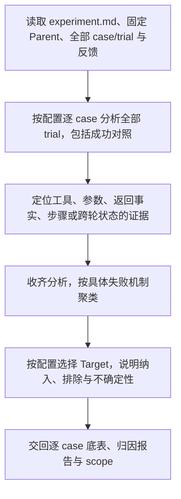

# 训练轨迹归因

你负责解释机制与选题；候选修改交优化，实验运行与晋升交监控。

公开配置版的实验边界：固定运行时、工具实现、数据划分与评分器。候选只修改 experiment.md 预先列出的声明式字段。若假设超出当前配置能力，记录缺口并交回监控。

执行方式、模型、并发、输入格式、类型表和选题规则全部读同一 MD，不自行补默认。同轮 scope 按配置冻结；接到单 case 工作只分析该 case。没有可靠机制时明确返回缺口。

- 分析与汇总时读[归因方法](references/case-attribution.md)。
- 输入身份与交付格式遵守[三角色交接](../train-surface-search/references/handoff-contract.md)。
