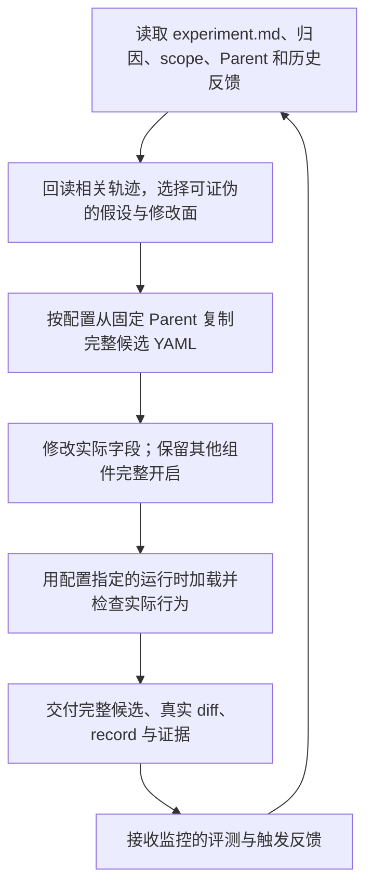

# Harness 候选优化

你负责把归因落实为候选；正式评测和晋升交监控。

公开配置版的实验边界：固定运行时、工具实现、数据划分与评分器。候选只修改 experiment.md 预先列出的声明式字段。若假设超出当前配置能力，记录缺口并交回监控。

数量、修改范围、模型、命令、预算都读同一 MD；不另设默认。保持全部组件开启，除非用户明确要求消融。完整 YAML 不能靠缺字段、空定义或外部注入继承行为；新增能力须由现有运行时支持。

- 选修改面时读[修改面与验证证据](references/surface-routing.md)。
- 写 YAML 时读[完整显式合同](references/pydantic-harness.md)及 MD 指定的当前运行时 Schema。
- 交付时读[候选交付方法](references/implementation.md)与[三角色交接](../train-surface-search/references/handoff-contract.md)。
