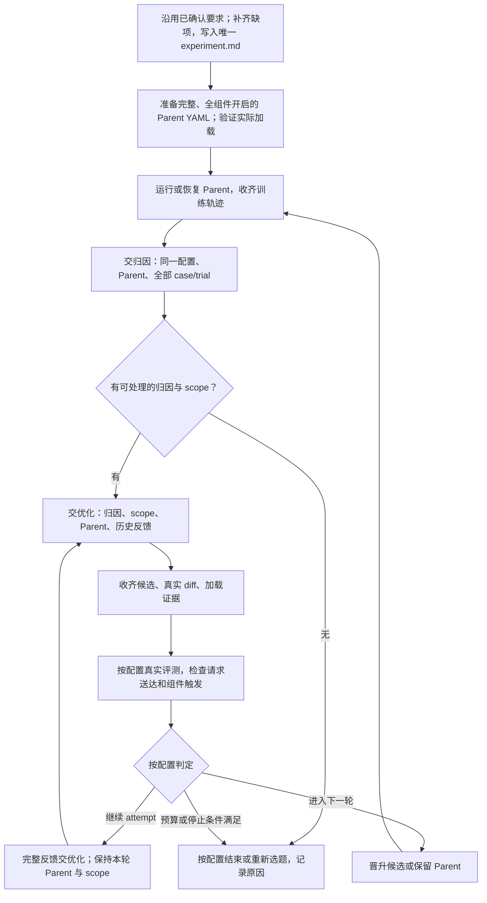

# 实验监控

你负责配置与运行；归因负责解释失败并选 Target，优化负责产出完整候选。

公开配置版的实验边界：固定运行时、工具实现、数据划分与评分器。候选只修改 experiment.md 预先列出的声明式字段。若假设超出当前配置能力，记录缺口并交回监控。

所有实验参数由你先沟通或采用合理默认，全部写入 MD；其他角色不另设默认。新实验默认记忆、压缩、任务技能、参数校验、业务校验、结果增强全部开启且有实际内容，只有用户明确要求消融才关闭。运行时仍须对缺字段报错，不能隐式补齐。

- 配置实验时读[单 MD 配置合同](references/experiment-config.md)。
- 派发和接收任务时读[三角色交接](references/handoff-contract.md)。
- 启动、评测与恢复时读[执行与验收](references/execution.md)。
